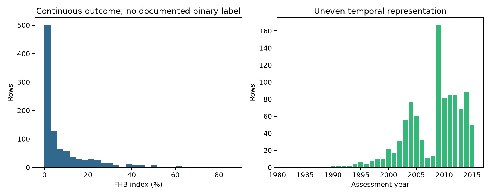
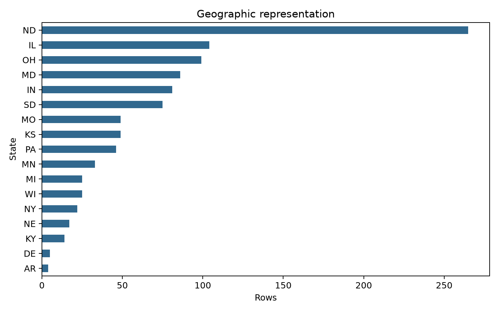
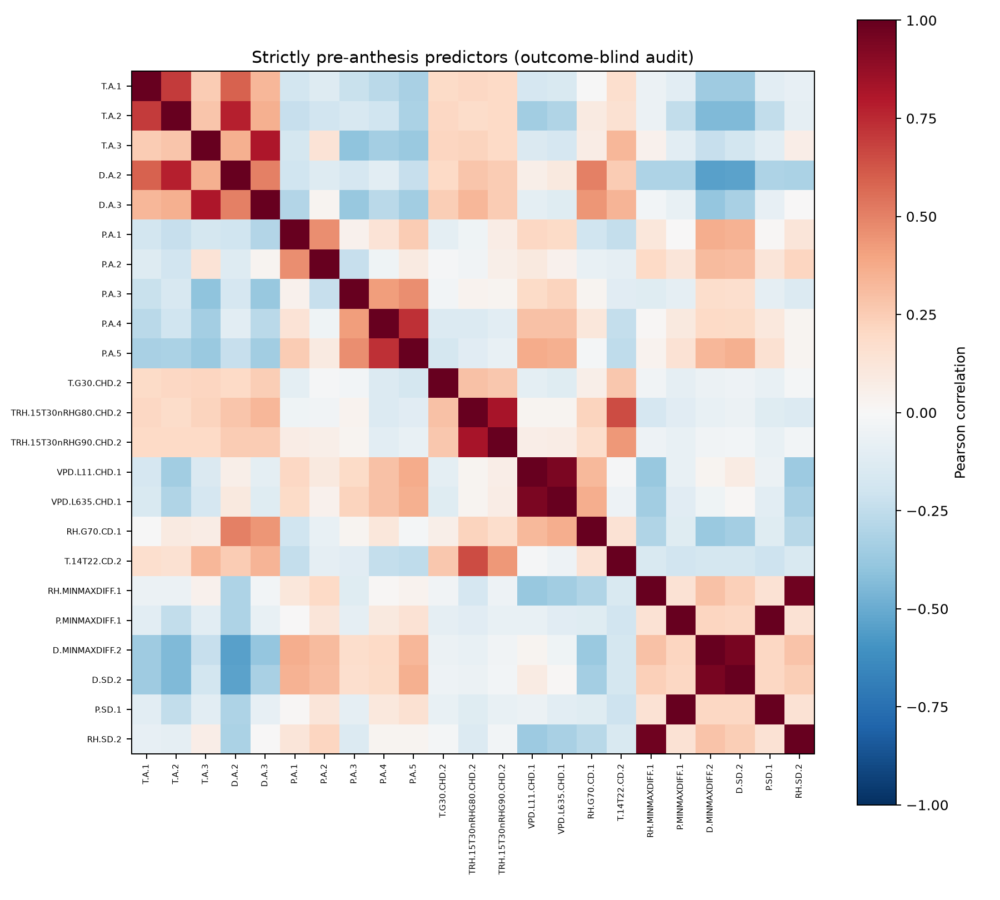

# Independent structural and exploratory data audit

Source: [Zenodo record 23189372](https://zenodo.org/records/23189372), version 2.1.0, published 2026-10-06, accessed 2026-10-10. Authors: Denis A. Shah, Erick D. De Wolf, Pierce A. Paul and Laurence V. Madden. License: CC BY 4.0. The API was retrieved after the web reader failed and a sandboxed curl attempt could not resolve the host. Network-enabled downloads succeeded. Original files are preserved in data/raw; outputs/manifest.csv includes source URLs, MD5 and SHA256. Every downloaded file matched Zenodo's MD5. The primary data were read with PyArrow and the dictionary with PyYAML.

## Unit, coverage, and response

There are 999 rows and 337 columns, including 329 weather-derived variables. The record calls them fungicide-untreated small-plot field observations; the YAML calls the table plot-level. Row IDs are unique (1–999). Neither replicate counts, trial/site identifiers, station IDs, geographic coordinates, nor rules for averaging multiple field measurements are supplied. Noninteger severity is consistent with measurement/aggregation but does not establish the exact experimental unit independently. Do not equate a row with an independent field, station, or epidemic.

Coverage: 17 conterminous U.S. states and 32 observed years, 1982–2015 (1983 and 1985 absent). Anthesis dates are UTC midnight, 1982-05-26 through 2015-07-14. ND contributes 265 rows; IL 104 and OH 99; AR and DE have only 4 and 5. Years 1982–1989 each have one observation in the six years represented; 2009 has 167. Complete counts are in outputs/by_year.csv and by_state.csv, with a state-year matrix in state_year_counts.csv. This convenience research collection is not a probability sample of U.S. wheat fields.

The **only documented response is S**, FHB index/severity of symptoms on the spike, percent (valid range 0–100). The HTML describes it as a percentage. The dictionary does not state the incidence-by-severity formula, timing/protocol of assessment, or how to aggregate replicates. S has mean 8.813%, median 2.868%, quartiles 0.197% and 11.314%, range 0–86.18%; 186 rows (18.62%) equal zero. This is continuous severity. There is **no binary epidemic response and no cutoff**, including the boundary operator, documented in the released files. The only two-level fields are wheat type and corn residue, neither an outcome. Binary prevalence, events and nonevents are therefore undefined for the requested target. Zero versus nonzero severity is not an authorized substitute.

Metadata/grouping fields: year, state, UTC anthesis date, spring/winter wheat type, cultivar resistance VS/S/MS/MR, corn residue (0/1). Resistance frequencies are 135/412/213/239 respectively. These influence severity and may shift between environments; weather-only probabilities marginalize over this sampled mixture.

## Weather definitions and timing

The YAML is authoritative for units/conditions, not column-name heuristics. Units include degC (air temperature, dewpoint, temperature-dewpoint depression), percent (RH), kPa (VPD), hPa (pressure), days and hours (threshold counts), and hours^2 for the legacy product INT3. P means **barometric pressure**, not precipitation. The release contains aggregated station weather rather than raw hourly/daily series. Completeness of underlying observations, QC, station-to-field distance, interpolation, missing-hour treatment, reporting latency and representativeness are not established.

The README uses the nearest station reporting in the needed period, including citizen stations, accessed through Mathematica WeatherData. Anthesis reference is 00 UTC; full days are 00–23 UTC. Overnight periods are 20–07 UTC in the README, equivalent to the YAML's 20:00–08:00 exclusive endpoint, but the cross-midnight assignment to a calendar day is insufficiently explicit for reconstructing hourly windows.

YAML conventions explicitly make day intervals **closed**. There are 174 summaries labeled pre, 137 post, and 18 pre-post. Of the pre summaries, **151 end at day 0** and thus contain weather later than the documented prediction instant. Their names do not make them eligible. Only 23 nondeprecated variables end strictly before day 0 (listed in outputs/audit_summary.json). None provides an unambiguous completed-day summary of the final four days immediately before anthesis. Both raw data and exact aggregation code would be needed to create clean recent windows; subtraction/reconstruction is not assumed valid.

## Schema checks and documentation discrepancies

All 337 YAML names match the Parquet schema exactly, and all 329 weather names match the CSV metadata. Numeric CSV values agree with Parquet within 1e-10 tolerance, including S. Factors and UTC dates survive Parquet ingestion. Documented category levels, integer-valued entries, missing percentages, observed numerical ranges, theoretical ranges and identical_to declarations pass the implemented checks (outputs/schema_audit.csv). Numeric range tolerance is 1e-6; missing-percentage tolerance is 0.055 percentage points. These checks do not establish raw-weather quality or semantic correctness.

A substantive timing inconsistency remains: **all 329 CSV win_length entries equal endpoint difference, whereas YAML closed intervals imply endpoint difference + 1**. For example, VPD.L635.CHD.1 has [-15,-5]: CSV length 10, YAML 11 days and maximum 264 hours. The observed maximum is 238 hours, which cannot resolve the inclusion convention. Follow YAML for eligibility and document the discrepancy; do not silently translate endpoints. The README's file inventory omits the new Parquet/YAML files despite mentioning them in version notes. The requested binary outcome does not appear in any released schema or outcome documentation. These are substantive gaps despite exact column-name agreement.

## Missingness, redundancy, extremes and dependence

Only corn residue has missing cells: 4/999 (0.4004%). S and all released weather summaries are complete. Complete summaries do not demonstrate complete underlying weather records. No numerical value violates its YAML valid range. Standardized scans of 23 eligible variables flag 115 rows with at least one absolute z-score >3. Largest values (7.262) occur in a repeated SD 2006 weather environment. These are screening flags across multiple predictors, not fitted-model influence diagnostics or grounds for exclusion. Full rows are in outputs/extreme_rows.csv.

There are five exact numerical weather alias pairs (outputs/identical_weather_pairs.csv), all involving post-anthesis variables. Among eligible variables, strong correlations include pressure range versus SD (r=0.994), RH range versus SD (0.970), dewpoint range versus SD (0.947), and the two low-VPD hour thresholds (0.939). Avoid redundant covariates; the full eligible-variable correlation matrix and ranked pairs are saved. No outcome-driven selection was performed.

999 rows contain only **545 unique full-weather profiles**; 265 profiles have multiple rows, 280 are singletons, and maximum profile size is 8. Some replicated weather profiles contain different cultivar resistance and disease levels. There are 142 state-years and 492 state-date combinations. These are dependency proxies, not confirmed trial identities: state-date may merge unrelated sites, and weather equality may omit shared dependencies across overlapping periods. Two records duplicate every column except ID: IDs 353/358 and 365/368, both MI. They may be valid repeated measurements; retain them without inventing provenance, with removal a potential sensitivity analysis.

A size-imbalance proxy n²/sum(cluster_size²), grouping by identical weather profile, is 395.25. It is a Kish-style descriptive weighting quantity, **not an estimated effective sample size for regression**; correlations and event distribution are needed for that. Only 32 years support year-level validation/uncertainty, and many early groups are tiny. The number of independent epidemic events is unknown. Searching 329 predictors, or even all 23 eligible ones, cannot be justified merely by n=999. A maximum of three parameters does not solve an undefined target or missing trial structure.

## Independent feasibility conclusion

The data support descriptive weather/severity analysis. They do not support the requested **documented binary epidemic prediction** as currently specified. No primary model, binary performance metric, influence diagnostic, or calibration plot can be defensibly produced before a response definition is established. This is missing essential target metadata, not evidence that weather has no predictive value. Independent results and the original conditional plan are recorded before searching the literature.

## Later target audit (after independent freeze; before fitting)

The post-analysis literature search resolved an operational definition: S>=10%, from Equation 1 in [Shah et al. 2021](https://journals.plos.org/ploscompbiol/article?id=10.1371/journal.pcbi.1008831). This produces 273 events, 726 nonevents and 27.327% prevalence, matching that study's published event count. The release itself still lacks this definition; it is recorded as a source-informed repair, not a discovery in the YAML. Two observations equal exactly 10%, so the inclusive operator matters. Nine years and four states have no events; their AUC cannot be estimated. Resistance-specific prevalences vary markedly (VS 46.67%, S 32.04%, MS 22.07%, MR 12.97%). See analysis_plan_revisions.md and the target_by_* tables. Subsequent predictive fits are therefore a literature-informed continuation of the originally outcome-blind specifications.
