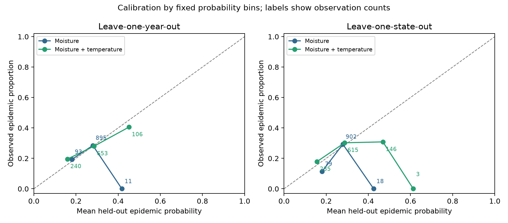
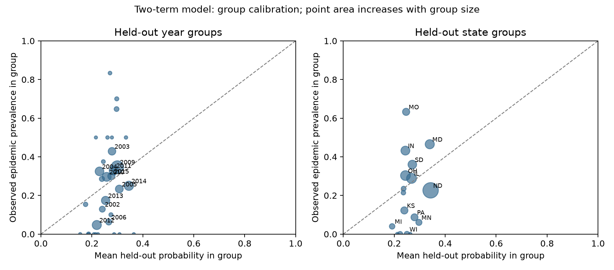

# Final results — literature-informed continuation

The two-term moisture/temperature logistic model is the provisional research specification. It improves Brier score, discrimination and calibration over the one-term baseline on pooled year-held-out predictions, while a third quadratic parameter adds no benefit. Its discrimination remains modest and group/subgroup calibration is inadequate for deployment. The paired uncertainty interval includes no improvement, so superiority is not firmly established.

**Provenance:** the independent audit and conditional predictor plan were completed before the literature search. No model was fitted then because the release lacked a binary definition. The cited 2021 paper subsequently supplied S>=10%; the before-fitting revision is analysis_plan_revisions.md. The independent snapshot remains preserved. The models use weather terms prespecified before literature review; the outcome definition and actual fitting phase are literature-informed.

## Target and information size

There are 273 events and 726 nonevents in 999 observations (27.327% prevalence). There are 171 distinct complete weather profiles carrying at least one event and 427 carrying at least one nonevent; 53 profiles contain both outcomes. Events occur in 23/32 years and 13/17 states. These are dependency summaries, not estimates of independent event counts. Nine years and four states have no events. Per-fold training event counts are saved in group_performance.csv. The low fixed complexity (1–3 predictor parameters) supports exploratory estimation; the clustered observational design and omitted host information prevent assuming stable deployable risk.

## Fixed model specifications and full-data estimates

- Intercept reference: zero predictor parameters, one intercept, fitted separately in every training fold.
- moisture: VPD.L635.CHD.1 hours/24, one predictor parameter plus intercept.
- moisture_temp: same moisture plus (T.A.2 - 15)/5, two predictor parameters plus intercept.
- moisture_temp_quad: also squared scaled temperature, three predictor parameters plus intercept.
- temp_earlier / temp_remote: same two-term structure, replacing T.A.2 with T.A.1 / T.A.3, respectively.

Every source window ends strictly before day 0. VPD <=0.635 kPa hours cover [-15,-5] (11 closed days); T.A.2 covers [-20,-10] (11 closed days). No post-anthesis or anthesis-day weather is used. There is no imputation, estimated standardization, automated selection, tuning or random row splitting.

The provisional equation is:

`logit(p) = -3.023409 + 0.282323 * (VPD.L635.CHD.1 / 24) + 0.782709 * ((T.A.2 - 15) / 5)`

`p = 1 / (1 + exp(-logit(p)))`.

Scaling is fixed and supplied with coefficients in outputs/fitted_model.json. The moisture-only baseline is `logit(p) = -2.207773 + 0.193378 * (hours/24)`. Full-data fitting is for the research model artifact; all performance below comes from held-out predictions.

Approximate 95% coefficient intervals use year-clustered sandwich covariance with finite-sample correction and t(31) critical values. They condition on the fixed specification and do not account for prior feature curation, model choice, or all dependencies among sites/years.

| model | term | beta | se_cluster_year | lower | upper | odds_ratio | OR_lower | OR_upper |
| --- | --- | --- | --- | --- | --- | --- | --- | --- |
| moisture | intercept | -2.2078 | 0.6942 | -3.6236 | -0.7919 | 0.1099 | 0.0267 | 0.4530 |
| moisture | VPD.L635.CHD.1 | 0.1934 | 0.1055 | -0.0218 | 0.4085 | 1.2133 | 0.9785 | 1.5046 |
| moisture_temp | intercept | -3.0234 | 0.7672 | -4.5882 | -1.4586 | 0.0486 | 0.0102 | 0.2326 |
| moisture_temp | VPD.L635.CHD.1 | 0.2823 | 0.1036 | 0.0710 | 0.4936 | 1.3262 | 1.0736 | 1.6382 |
| moisture_temp | T.A.2 | 0.7827 | 0.2475 | 0.2780 | 1.2874 | 2.1874 | 1.3205 | 3.6234 |

An extra 24 low-VPD hours is associated with OR 1.326 (1.074–1.638) in the two-term model; 5 degC higher prior temperature with OR 2.187 (1.320–3.623). These are conditional predictive associations, not effects of experimentally changing weather. The moisture-only interval includes no association. All predictive MLE fits converged, and final outputs contain no fitting warnings. Main-candidate predictor correlation is -0.301.

## Grouped validation

Primary: leave-one-year-out over 32 years. Secondary: leave-one-state-out over 17 states. Temporal: train 1982–2008 (374 rows, 110 events), evaluate 2009–2015 (625 rows, 163 events). Historical year-out training includes later years, so temporal validation is an additional deployment check. Fixed features are used without selection; all regression coefficients and profile-balancing training weights are estimated within each training fold.

| model | strategy | predictor_parameters | n | auc | brier | log_loss | calibration_in_large | calibration_intercept | calibration_slope |
| --- | --- | --- | --- | --- | --- | --- | --- | --- | --- |
| intercept | year | 0 | 999 | 0.3528 | 0.2006 | 0.5914 | 0.0056 | — | — |
| intercept | state | 0 | 999 | 0.3421 | 0.2015 | 0.5939 | -0.0069 | — | — |
| intercept | temporal | 0 | 625 | 0.5000 | 0.1939 | 0.5766 | -0.1663 | — | — |
| moisture | year | 1 | 999 | 0.5413 | 0.1995 | 0.5882 | 0.0051 | -0.6011 | 0.3795 |
| moisture | state | 1 | 999 | 0.5363 | 0.1994 | 0.5874 | -0.0038 | -0.5507 | 0.4345 |
| moisture | temporal | 1 | 625 | 0.5719 | 0.1906 | 0.5677 | -0.1203 | 0.0095 | 1.1435 |
| moisture_temp | year | 2 | 999 | 0.6158 | 0.1932 | 0.5741 | 0.0004 | -0.2132 | 0.7729 |
| moisture_temp | state | 2 | 999 | 0.6044 | 0.1965 | 0.5803 | -0.0578 | -0.4024 | 0.6100 |
| moisture_temp | temporal | 2 | 625 | 0.6278 | 0.1890 | 0.5628 | -0.2782 | -0.4684 | 0.7269 |
| moisture_temp_quad | year | 3 | 999 | 0.6143 | 0.1939 | 0.5770 | -0.0010 | -0.2898 | 0.6923 |
| temp_earlier | year | 2 | 999 | 0.5899 | 0.1961 | 0.5822 | 0.0021 | -0.3613 | 0.6197 |
| temp_remote | year | 2 | 999 | 0.5450 | 0.1996 | 0.5892 | 0.0154 | -0.5915 | 0.3823 |

Calibration-in-the-large uses an offset regression with slope fixed at 1 (ideal 0). Calibration intercept/slope are jointly fitted diagnostics (ideal 0/1). They do not recalibrate test predictions. The year-out two-term calibration slope of 0.773 indicates probabilities are somewhat too spread out; state-out slope 0.610 is weaker. In the temporal holdout it predicts a mean 31.32% epidemic frequency against 26.08% observed, with calibration-in-large -0.278. Pooled mean calibration near zero in year-out validation conceals environment and host heterogeneity.

The intercept comparator's pooled AUC is below 0.5 because folds have different training prevalences, inversely related to held-out-group prevalence; each individual fold gets a constant score and has AUC=0.5 when both classes exist. Do not read this cross-fold artifact as a meaningful anti-predictive classifier. Its Brier/log loss remain useful out-of-fold reference scores. Joint calibration slope is intentionally not reported for this reference.

Year-block percentile intervals below use 1000 resamples of fixed out-of-fold predictions (seed 20261010), preserving year groups and pairing model comparisons. They describe uncertainty conditional on those predictions; they omit full model-refitting/selection uncertainty and are not formal proof of superiority.

| model | metric | lower | upper | resamples |
| --- | --- | --- | --- | --- |
| moisture | auc | 0.4452 | 0.6245 | 1000 |
| moisture | brier | 0.1727 | 0.2215 | 1000 |
| moisture_temp | auc | 0.5280 | 0.7126 | 1000 |
| moisture_temp | brier | 0.1626 | 0.2182 | 1000 |
| moisture_temp minus moisture | paired_brier_difference | -0.0134 | 0.0013 | 1000 |

The two-term-minus-one-term Brier difference is -0.00628, but its interval (-0.01343, 0.00129) crosses zero. Relative to the year-out intercept comparator, the two-term model lowers Brier by 0.00732 (3.65%); this is a small gain. No external sample validates the final choice made after inspecting these comparisons.

## Environment variability and calibration plots

Year-specific AUC for the two-term model ranges 0.222–1.000 where estimable; nine single-class years are undefined. Some AUC=1 groups have only one or two events. For example, 2013 has AUC 0.222 (12/69 events), 2012 0.937 (4/85), and 2009 0.671 (58/167). State AUC ranges 0.357–1.000 where estimable; four states are undefined. MO has observed prevalence 63.27% versus mean held-out prediction 24.66%, Brier 0.378; ND 22.64% versus 34.28%. This heterogeneity matters more than a single pooled score. No tiny-group calibration slopes are reported.

The five fixed equal-width bins are descriptive and can hide within-bin patterns; observed bin proportions have cluster dependence. Empty bins have no points and no fictitious observations. No smoothed line is taken as a calibrated operational risk curve. Bin counts are in calibration_bins.csv; all held-out probabilities are in predictions.csv.

## Robustness and negative results

Thermal-window sensitivities reduce year-out AUC to 0.590 ([-25,-15]) and 0.545 ([-40,-30]), with Brier 0.1961 and 0.1996. The quadratic model has AUC 0.614 and Brier 0.1939, worse than the two-term model. No quadratic optimum is claimed, and the third parameter is rejected for this provisional specification. Moisture-window robustness is unresolved because a comparable recent closed-day window excluding day 0 is not supplied; no raw-time-series reconstruction was attempted.

| model | variant | n | auc | brier | calibration_in_large | calibration_slope |
| --- | --- | --- | --- | --- | --- | --- |
| moisture | remove_duplicates | 997 | 0.5415 | 0.1998 | 0.0049 | 0.3805 |
| moisture | profile_weighted | 999 | 0.5408 | 0.1993 | 0.0414 | 0.3875 |
| moisture_temp | remove_duplicates | 997 | 0.6145 | 0.1936 | 0.0004 | 0.7694 |
| moisture_temp | profile_weighted | 999 | 0.6157 | 0.1932 | 0.0217 | 0.7738 |

Removing the two unresolved duplicate records barely changes performance. Profile-balanced training weights (computed only in training data) also leave the results close. Scoring each distinct full-weather profile equally yields AUC 0.612 and Brier 0.1895 for the two-term model; this changes the evaluation population and is not proof of independence. Year-deletion full-data fits retain positive coefficients: moisture 0.214–0.336, temperature 0.654–0.943. Maximum ordinary-GLM Cook distance for the two-term model is 0.0138 (row ID 21); ID 411 is 0.0113. These are row-level diagnostics that can understate joint environmental influence. No rows were discarded for weather extremes or disease severity.

## Host-specific diagnostic limitation

| resist | n | events | prevalence | mean_prediction | auc | brier | calibration_in_large |
| --- | --- | --- | --- | --- | --- | --- | --- |
| VS | 135 | 63 | 0.4667 | 0.2663 | 0.7017 | 0.2655 | 0.9210 |
| S | 412 | 132 | 0.3204 | 0.2659 | 0.6392 | 0.2117 | 0.2759 |
| MS | 213 | 47 | 0.2207 | 0.2910 | 0.6018 | 0.1757 | -0.3881 |
| MR | 239 | 31 | 0.1297 | 0.2738 | 0.5630 | 0.1362 | -0.9606 |

Weather-only predictions strongly underpredict VS (46.67% observed versus 26.63% mean prediction) and overpredict MR (12.97% versus 27.38%). The weather-only marginal model is unsuitable as a cultivar-specific management risk equation. An agronomic extension could address this, but is beyond the fixed weather-only primary specification and would require a separately budgeted, validated plan.

## Computational problems retained

The first audit failed on unordered-factor extrema and was corrected without changing data. The first model run attempted unnecessary tiny-group calibration, producing separation/division warnings; these are retained in model_warnings_first_run.json. The final run limits calibration to pooled/subgroup diagnostics as planned, with no warnings in model_warnings.json. No predictive model was silently replaced after failure. Publisher access failures and the independent outcome gate are documented in analysis_log.md.

## Preserved independent results

### Independent results — before literature search

The reproducible audit completed on the 999-row version 2.1.0 dataset. No predictive model was fitted. The released YAML, README, weather metadata and HTML codebook document continuous severity S, but neither a binary epidemic label nor its cutoff. Logistic regression to S would violate the specified binary target; treating S>0 or applying an assumed severity threshold would change the estimand without documentation.

| Requested result | Independent status |
|---|---|
| Binary prevalence; events and nonevents | Undefined: target definition missing |
| Baseline logistic estimates | Not fitted: outcome gate failed |
| Scientifically motivated alternative | Prespecified conditionally in analysis_plan.md; not fitted |
| ROC AUC; Brier score; log loss | Not estimable for an undefined binary target |
| Calibration intercept/slope/plot | Not estimable |
| Predictor effect confidence intervals | Not estimable without fitting |
| Influence diagnostics | Not estimable; predictor-extreme scan is descriptive only |
| Validation-group variability | Counts/continuous severity available; binary model performance unavailable |

Robust descriptive findings: 337 columns exactly match the YAML; only corn has missing values (4). Numeric CSV and Parquet values agree. S ranges from 0 to 86.18%, median 2.868%; 186 rows are zero. Geography and years are unevenly represented. There are 545 distinct complete weather profiles and 142 state-years, indicating substantial potential dependence.

151 of 174 summaries labeled pre-anthesis contain day 0 under the YAML closed-window convention. At the documented 00 UTC prediction instant they are ineligible. 23 summaries end strictly earlier. The CSV window lengths conflict with the YAML by one day for all 329 weather variables. These constraints would still matter if a valid response definition were obtained.

See data_audit.md and the machine-readable outputs for all checks. This independent conclusion is finalized before the literature search. Any subsequent literature-informed analysis must be explicitly marked and preserve this record.
